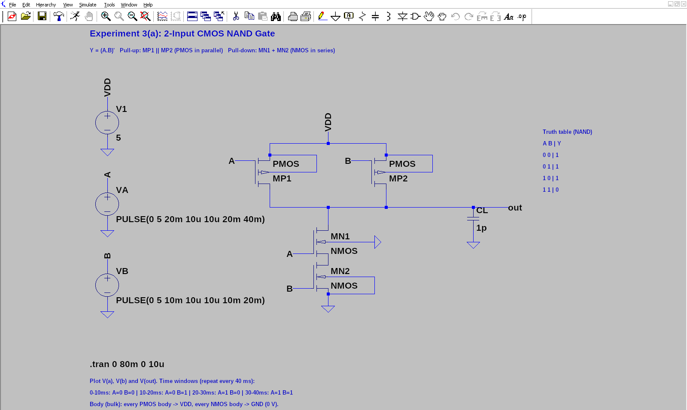
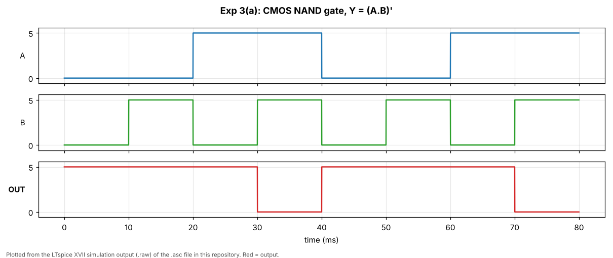
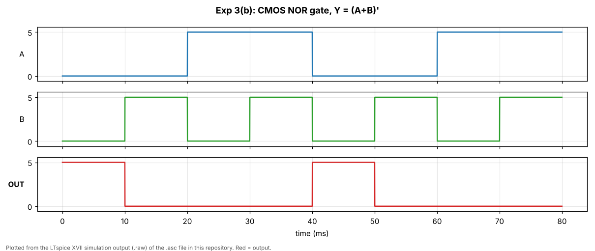
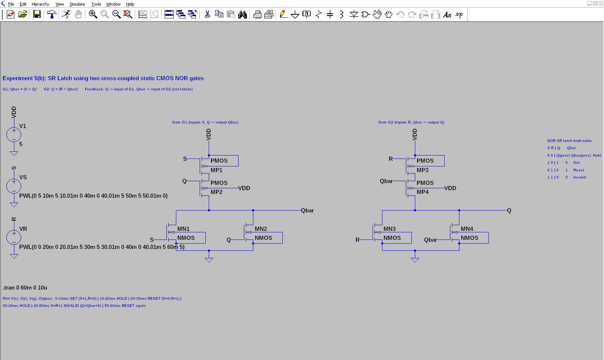
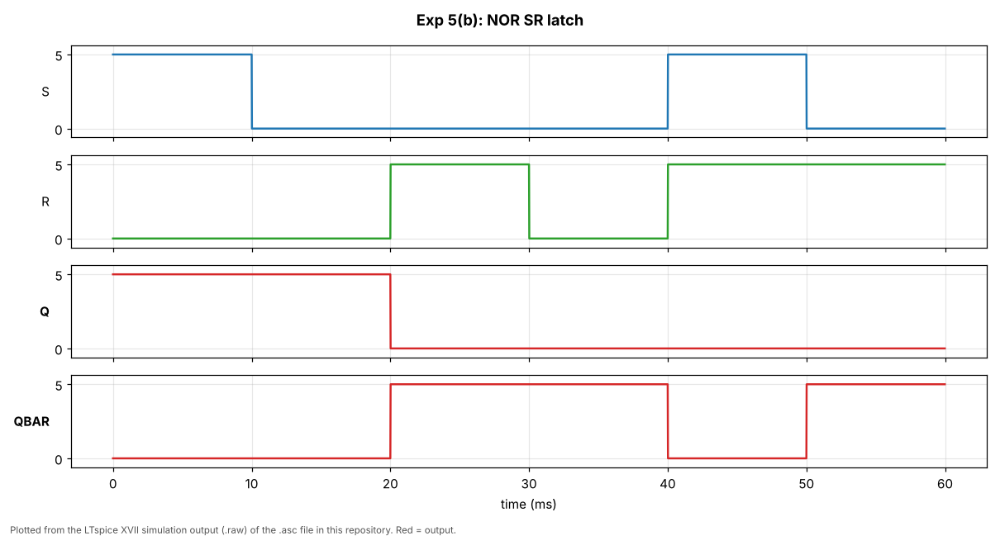
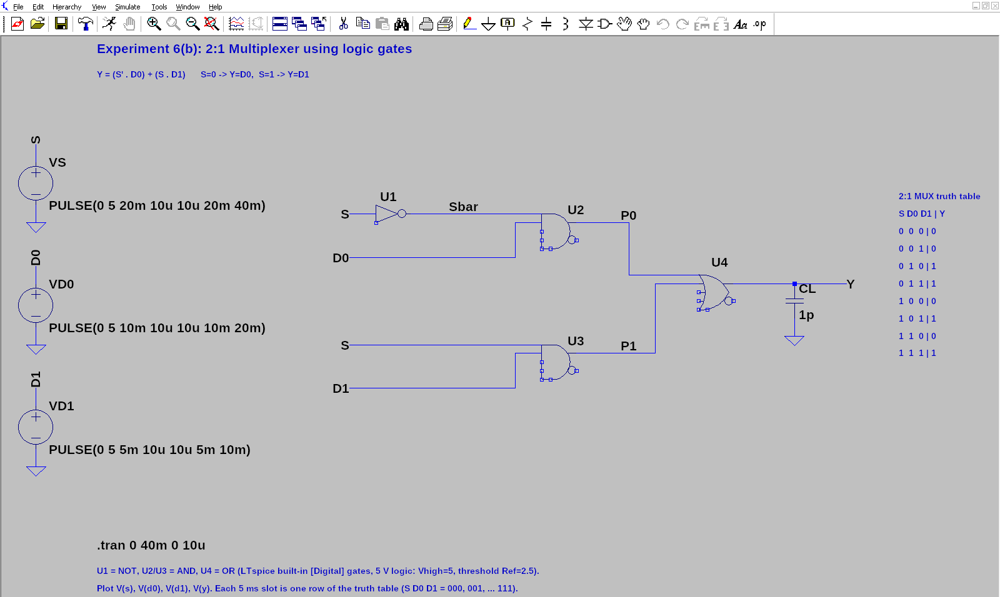
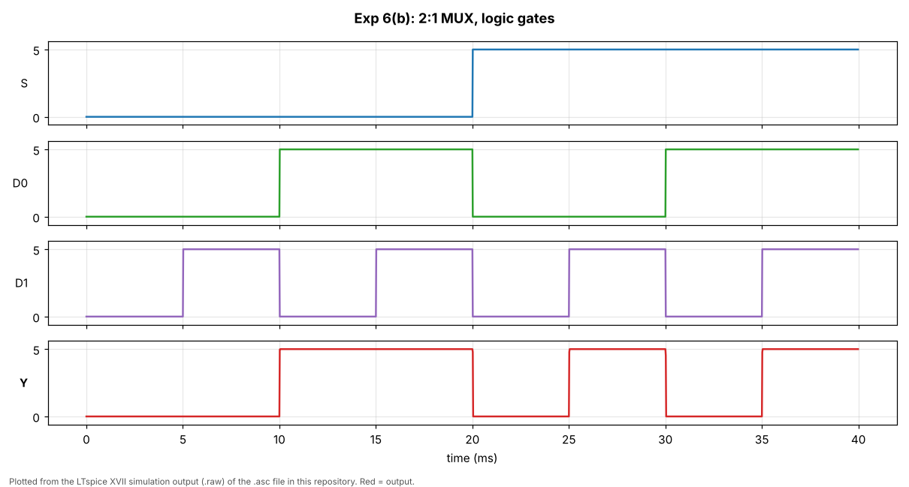
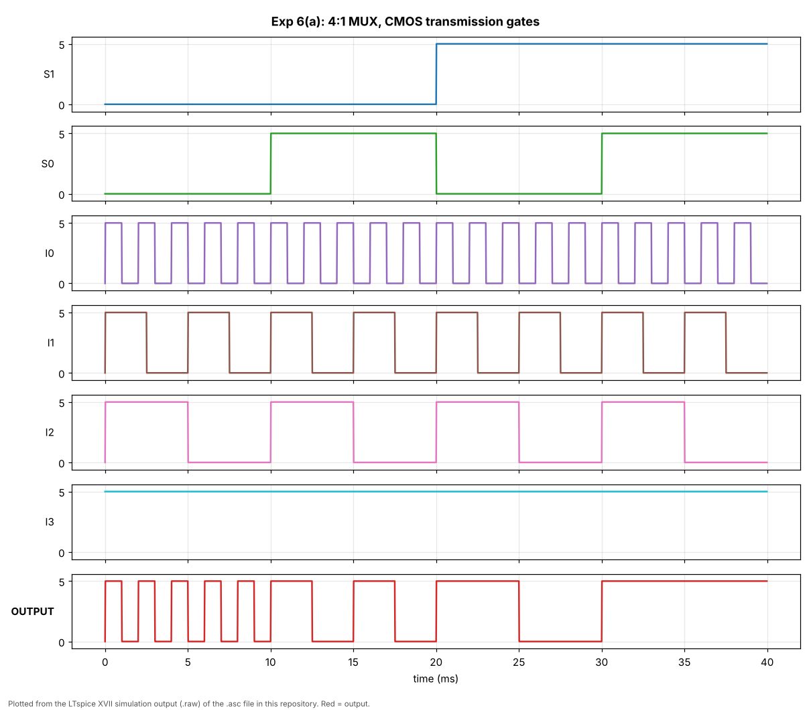
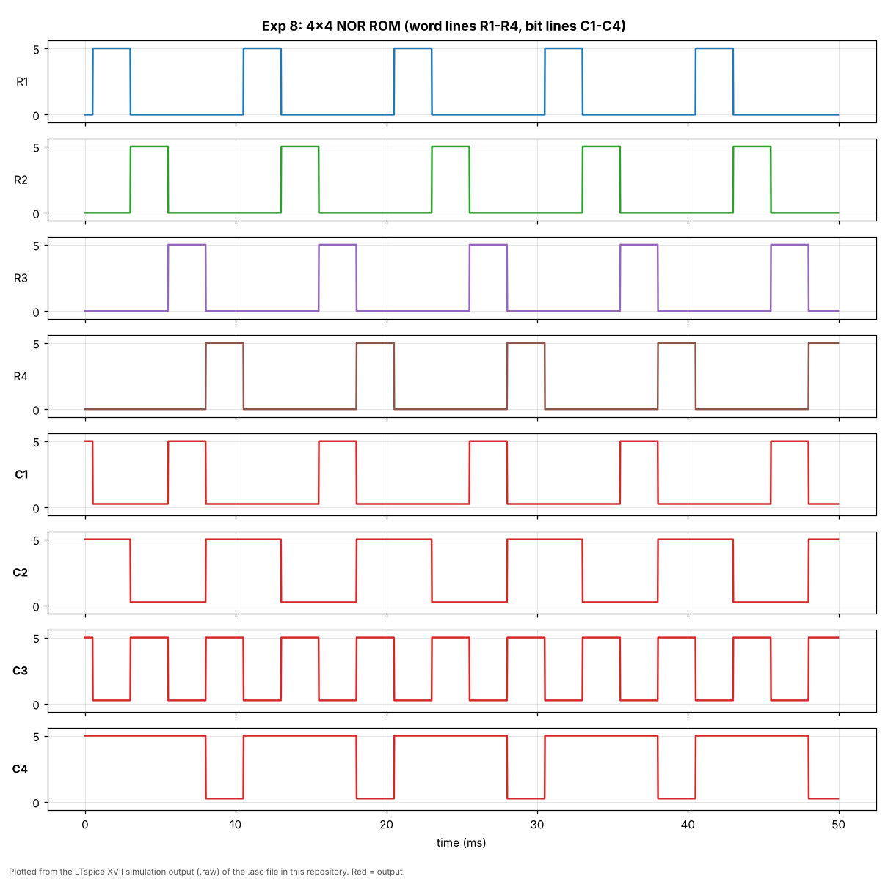

# VLSI Laboratory Experiments using LTspice

This repository contains all eight VLSI laboratory experiments as **ready-to-run LTspice schematic files (`.asc`)**.
Every file contains the complete circuit: transistors, wiring, net labels, input sources, supply and the
simulation command. Download a file, open it in LTspice, click **Run**, and look at the waveforms. You don't need to rebuild anything.

Every circuit in this repository was simulated with LTspice, and its outputs were checked automatically against the expected
truth table (see [Documentation/VERIFICATION.md](Documentation/VERIFICATION.md)).

---

## Software requirements

| Item | Details |
|---|---|
| **LTspice** (free, by Analog Devices) | Download from <https://www.analog.com/en/resources/design-tools-and-calculators/ltspice-simulator.html>. Any recent version works (LTspice XVII or LTspice 24.x). |
| Operating system | Windows 10/11, or macOS (LTspice for Mac). Linux users can run the Windows version with Wine. |
| Additional software | **None.** No extra models or libraries are needed. Only standard LTspice symbols are used (`nmos4`, `pmos4`, `voltage`, `cap` and the built-in `Digital` gates `inv`, `and`, `or`). The MOSFETs use LTspice's built-in default `NMOS` / `PMOS` models, the same as in the lab manual. |

---

## Download

### Download the whole repository (ZIP)
1. Open the repository page: <https://github.com/Sylvreen-Npu/vlsi-lab>
2. Click the green **Code** button.
3. Click **Download ZIP**.
4. Extract (unzip) the downloaded file.
5. Open any `.asc` file in LTspice.

Direct ZIP link: <https://github.com/Sylvreen-Npu/vlsi-lab/archive/refs/heads/main.zip>

### Download a single experiment file
1. Open the experiment folder on GitHub (for example `Experiment-03-NAND-NOR-Gates`).
2. Click the `.asc` file (for example `NAND-Gate.asc`).
3. Click the **Download raw file** button (the download-arrow icon at the top-right of the file view).
4. Save it with the `.asc` extension and open it in LTspice.

> Do **not** use the browser's *Save page as…* on the GitHub page. That saves an HTML web page, not the LTspice file.
> Always use **Download raw file**. You can also use a link of the form
> `https://github.com/Sylvreen-Npu/vlsi-lab/raw/main/<folder>/<file>.asc`.

No GitHub account or login is needed to view or download anything.

---

## How to simulate (step by step)

1. **Download** the experiment file (see above).
2. **Open** the `.asc` file in LTspice (double-click it, or *File → Open*).
3. **Check the circuit.** The schematic shows the title, the transistors, the input sources (left side), the supply `V1 = 5 V`,
   and the simulation command (for example `.tran 0 80m 0 10u`) in black text.
4. **Click Run.** Use the running-man icon, or *Simulate → Run*.
5. **Select nodes to plot.** Click a wire or net label in the schematic, for example the wire labelled `out`.
   The voltage of that node appears in the waveform window. Repeat for the inputs (`A`, `B`, …).
   The blue text on each schematic tells you exactly which nodes to plot.
   *Tip:* to put each signal in its own pane, right-click the waveform window → *Add Plot Pane*, then click a node.
6. **Observe the waveform** and compare it with the truth table printed on the schematic and in this README.

---

## Experiment list

| No. | Experiment | Files | Description |
|---|---|---|---|
| 1 | NMOS and PMOS characteristics | `NMOS-Transfer-Characteristics.asc` `NMOS-Drain-Characteristics.asc` `PMOS-Transfer-Characteristics.asc` `PMOS-Drain-Characteristics.asc` | DC sweeps of `Id` vs `Vgs` (transfer) and `Id` vs `Vds` (drain, stepped `Vgs`). Plot `Id(M1)`. |
| 2 | CMOS inverter | `Inverter-DC-VTC.asc` `Inverter-Transient.asc` | Voltage transfer characteristic (`.dc` sweep of Vin) and transient switching. Plot `V(vout)` (input node `V(n002)`). |
| 3 | CMOS NAND and NOR gates | `NAND-Gate.asc` `NOR-Gate.asc` | **Corrected and simplified.** 2-input static CMOS NAND and NOR. Plot `V(a)`, `V(b)`, `V(out)`. |
| 4 | Static CMOS logic expressions | `Y1-NOT-A-plus-BC.asc` → Y = (A + B·C)' `Y2-NOT-A-plus-B-times-C.asc` → Y = ((A + B)·C)' | Complex static CMOS gates. Plot `V(a)`, `V(b)`, `V(c)`, `V(out)`. |
| 5 | SR latch | `SR-Latch-NAND.asc` `SR-Latch-NOR.asc` | NAND-based latch (active-LOW inputs), plus a **new** NOR-based latch. |
| 6 | Multiplexer | `MUX-4to1-TG.asc` `MUX-2to1-Gates.asc` `MUX-2to1-TG.asc` | 4:1 MUX using CMOS transmission gates, plus a **new** 2:1 MUX (gate-level, and a transmission-gate version). |
| 7 | Static CMOS half adder | `Half-Adder.asc` | Sum = A ⊕ B, Carry = A·B. Plot `V(a)`, `V(b)`, `V(sum)`, `V(carry)`. |
| 8 | NOR-based ROM | `NOR-ROM-4x4.asc` | 4×4 pseudo-NMOS NOR ROM. Plot word lines `V(r1)`–`V(r4)` and bit lines `V(c1)`–`V(c4)`. |

Each folder `Experiment-0N-…` contains that experiment's files. The `Documentation` folder contains:
* `schematics/`: LTspice screenshots of every schematic,
* `waveforms/`: simulation results plotted from LTspice's own output data,
* `VERIFICATION.md`: the measured results for every circuit and input combination,
* `CHANGES.md`: what was corrected compared with the original files, and why.

---

## Experiment details and truth tables

### Experiment 3: CMOS NAND and NOR gates
The two inputs follow a binary count: A = 0, 0, 1, 1 and B = 0, 1, 0, 1 in consecutive 10 ms windows, repeated every 40 ms,
so **all four input combinations** appear in the waveform.

* **NAND:** two PMOS in **parallel** (pull-up), two NMOS in **series** (pull-down).
* **NOR:** two PMOS in **series** (pull-up), two NMOS in **parallel** (pull-down).
* Every PMOS body is connected to VDD, and every NMOS body to GND.

| A | B | NAND Y | NOR Y |
|---|---|---|---|
| 0 | 0 | 1 | 1 |
| 0 | 1 | 1 | 0 |
| 1 | 0 | 1 | 0 |
| 1 | 1 | 0 | 0 |

### Experiment 4: Static CMOS logic expressions
| A | B | C | Y1 = (A + BC)' | Y2 = ((A + B)C)' |
|---|---|---|---|---|
| 0 | 0 | 0 | 1 | 1 |
| 0 | 0 | 1 | 1 | 1 |
| 0 | 1 | 0 | 1 | 1 |
| 0 | 1 | 1 | 0 | 0 |
| 1 | 0 | 0 | 0 | 1 |
| 1 | 0 | 1 | 0 | 0 |
| 1 | 1 | 0 | 0 | 1 |
| 1 | 1 | 1 | 0 | 0 |

### Experiment 5: SR latch (NAND-based and NOR-based)

**(a) NAND SR latch** (`SR-Latch-NAND.asc`). Inputs are **active-LOW** (S = S', R = R'). Plot `V(s)`, `V(r)`, `V(q)`, `V(q_)`.

| S' | R' | Q | Q' | Operation |
|---|---|---|---|---|
| 1 | 1 | Q(prev) | Q'(prev) | Hold |
| 0 | 1 | 1 | 0 | Set |
| 1 | 0 | 0 | 1 | Reset |
| 0 | 0 | 1 | 1 | Invalid |

**(b) NOR SR latch** (`SR-Latch-NOR.asc`, new). It has the same structure as the NAND latch, but uses two cross-coupled
2-input static CMOS NOR gates: G1 gives Qbar = (S + Q)' and G2 gives Q = (R + Qbar)'. The feedback connections are made by
the net labels `Q` and `Qbar` (each label connects to the gate input with the same name).
The input sequence demonstrates every case in turn: **Set → Hold → Reset → Hold → Invalid (S = R = 1) → Reset**.
Plot `V(s)`, `V(r)`, `V(q)`, `V(qbar)`.

| S | R | Q | Qbar | Operation |
|---|---|---|---|---|
| 0 | 0 | Q(prev) | Qbar(prev) | Hold |
| 1 | 0 | 1 | 0 | Set |
| 0 | 1 | 0 | 1 | Reset |
| 1 | 1 | 0 | 0 | Invalid (forbidden) |

### Experiment 6: Multiplexers

**(a) 4:1 MUX with CMOS transmission gates** (`MUX-4to1-TG.asc`). Two inverters generate S0' and S1'. Four first-level
transmission gates (controlled by S0) pick I0/I1 and I2/I3, and two second-level gates (controlled by S1) pick the pair.
Y = S1'S0'·I0 + S1'S0·I1 + S1S0'·I2 + S1S0·I3. Plot `V(s1)`, `V(s0)`, `V(i0)`–`V(i3)`, `V(output)`.

To make the selection easy to see, each data input has a different waveform: I0 is a fast square wave, I1 a slower one,
I2 a 5 ms pulse, and I3 is constant HIGH. In each 10 ms window the output copies exactly the selected input.

| S1 | S0 | Y |
|---|---|---|
| 0 | 0 | I0 |
| 0 | 1 | I1 |
| 1 | 0 | I2 |
| 1 | 1 | I3 |

**(b) 2:1 MUX with logic gates** (`MUX-2to1-Gates.asc`, new). One NOT, two AND and one OR gate (LTspice's built-in
`Digital` gates, set to 5 V logic). Y = (S'·D0) + (S·D1). Plot `V(s)`, `V(d0)`, `V(d1)`, `V(y)`.

**(c) 2:1 MUX with CMOS transmission gates** (`MUX-2to1-TG.asc`, new). This is the transistor-level version in the style of this
experiment: one inverter and two transmission gates. It uses the same inputs and gives the same truth table.

In both 2:1 files the inputs count through all 8 combinations, one row every 5 ms (S D0 D1 = 000, 001, …, 111).

| S | D0 | D1 | Y |
|---|---|---|---|
| 0 | 0 | 0 | 0 |
| 0 | 0 | 1 | 0 |
| 0 | 1 | 0 | 1 |
| 0 | 1 | 1 | 1 |
| 1 | 0 | 0 | 0 |
| 1 | 0 | 1 | 1 |
| 1 | 1 | 0 | 0 |
| 1 | 1 | 1 | 1 |

### Experiment 7: Static CMOS half adder
| A | B | Sum | Carry |
|---|---|---|---|
| 0 | 0 | 0 | 0 |
| 0 | 1 | 1 | 0 |
| 1 | 0 | 1 | 0 |
| 1 | 1 | 0 | 1 |

### Experiment 8: 4×4 NOR ROM
Word lines R1–R4 are pulsed one at a time. A transistor at a row/column crossing stores a 0, and no transistor stores a 1.

| Active row | C1 | C2 | C3 | C4 |
|---|---|---|---|---|
| R1 | 0 | 1 | 0 | 1 |
| R2 | 0 | 0 | 1 | 1 |
| R3 | 1 | 0 | 0 | 1 |
| R4 | 0 | 1 | 1 | 0 |

---

## Additional implementations (compared with the original files)
* **NAND and NOR gates (Exp 3):** redrawn as clean, simple CMOS gates that give the correct output for all four input combinations.
* **NAND-based and NOR-based SR latch (Exp 5):** the NAND latch is preserved (with its Q / Q' labels corrected), and a NOR latch was added.
* **4:1 and 2:1 multiplexers (Exp 6):** the 4:1 transmission-gate MUX is preserved in function and structure, and 2:1 MUXes were added
  (gate-level as requested, plus a transmission-gate version).

Experiments 1, 2 and 4 are **unchanged** (byte-for-byte the original files, only renamed).
Experiments 7 and 8 keep their original drawings, with very small wiring/sizing corrections.
All corrections, with before/after measurements, are listed in [Documentation/CHANGES.md](Documentation/CHANGES.md).

---

## Troubleshooting

| Problem | What to do |
|---|---|
| **File does not open in LTspice / LTspice shows HTML text** | You saved the GitHub web page instead of the file. Download it again with **Download raw file**, or download the ZIP. Make sure the file name ends in `.asc` (not `.asc.txt`). |
| **"Unknown subcircuit" / missing model** | Not expected: only standard LTspice parts are used. Make sure you are using a full LTspice installation (XVII or 24.x). The `NMOS` / `PMOS` model names are LTspice's built-in defaults and need no library. |
| **Simulation error / "time step too small"** | Reopen the original file (maybe a part was moved by accident), then run again. Do not delete the `.tran` / `.dc` command text. |
| **Input waveforms look wrong** | Right-click the source to see its `PULSE(...)`/`PWL(...)` value and compare it with this README. The time axis is in ms, and the run length is set by the `.tran` command. |
| **No output curve appears** | After clicking Run, click the wire or the label (`out`, `y`, `q`, `sum`, …) in the schematic to add it to the plot. For Exp 1, click a transistor to plot its current `Id(M1)`. |
| **The plot shows "V(n002)" etc.** | Unlabelled nodes get automatic names. Use the labelled nodes listed in the experiment table. |
| **Missing dependencies** | There are none. Each experiment is a single self-contained `.asc` file. |
| **Exp 6(b) gate symbols missing** | The NOT/AND/OR gates are in LTspice's standard `[Digital]` symbol folder, which every installation includes. |
