# VLSI Laboratory Experiments using LTspice

This repository contains all eight VLSI laboratory experiments as **ready-to-run LTspice schematic files (`.asc`)**.
Every file contains the complete circuit: transistors, wiring, net labels, input sources, supply and the simulation command.
Download a file, open it in LTspice, click **Run**, and look at the waveforms. You don't need to rebuild anything.

Each schematic also has **blue "VIEW …" labels next to the wires you should click** (for example `VIEW INPUT A -->`,
`VIEW OUTPUT Y = V(out)`) and a short **HOW TO VIEW WAVEFORMS** note. These labels are only text. They are not part of the circuit,
and you can delete them at any time (see [part E](#e-removing-the-visual-indicators)).

Every circuit was simulated with LTspice, and its outputs were checked automatically against the expected truth table
(see [Documentation/VERIFICATION.md](Documentation/VERIFICATION.md)).

**Contents:** [Software](#software-requirements) · [Download](#download) ·
[How to View Output Waveforms](#how-to-view-output-waveforms-in-ltspice) · [Signal reference tables](#signal-reference-tables-for-every-experiment) ·
[Experiment list](#experiment-list) · [Troubleshooting](#troubleshooting)

---

## Software requirements

| Item | Details |
|---|---|
| **LTspice** (free, by Analog Devices) | Download from <https://www.analog.com/en/resources/design-tools-and-calculators/ltspice-simulator.html>. Any recent version works (LTspice XVII or LTspice 24.x). |
| Operating system | Windows 10/11, or macOS (LTspice for Mac). Linux users can run the Windows version with Wine. |
| Additional software | **None.** No extra models or libraries are needed. Only standard LTspice symbols are used (`nmos4`, `pmos4`, `voltage`, `cap` and the built-in `Digital` gates `inv`, `and`, `or`). The MOSFETs use LTspice's built-in default `NMOS` / `PMOS` models, the same as in the lab manual. |

---

## Download

### Download the whole repository (ZIP)
1. Open the repository page: <https://github.com/NikhilKatti29/vlsi-lab>
2. Click the green **Code** button.
3. Click **Download ZIP**.
4. Extract (unzip) the downloaded file.
5. Open any `.asc` file in LTspice.

Direct ZIP link: <https://github.com/NikhilKatti29/vlsi-lab/archive/refs/heads/main.zip>

### Download a single experiment file
1. Open the experiment folder on GitHub (for example `Experiment-03-NAND-NOR-Gates`).
2. Click the `.asc` file (for example `NAND-Gate.asc`).
3. Click the **Download raw file** button (the download-arrow icon at the top-right of the file view).
4. Save it with the `.asc` extension and open it in LTspice.

> Do **not** use the browser's *Save page as…* on the GitHub page. That saves an HTML web page, not the LTspice file.
> Always use **Download raw file**. You can also use a link of the form
> `https://github.com/NikhilKatti29/vlsi-lab/raw/main/<folder>/<file>.asc`.

No GitHub account or login is needed to view or download anything.

---

# How to View Output Waveforms in LTspice

The pictures in this section are **real screenshots of LTspice XVII** using `Experiment-03-NAND-NOR-Gates/NAND-Gate.asc`.
Red boxes were added to the screenshots to show where to click. LTspice 24 looks slightly different (newer icons, and
*Undo* is Ctrl+Z), but the steps and menu names are the same.

## A. Running the simulation

1. **Open the `.asc` file.** Double-click it, or in LTspice use *File → Open*. The schematic appears.
   The blue `VIEW …` labels point to the wires you will click later.

   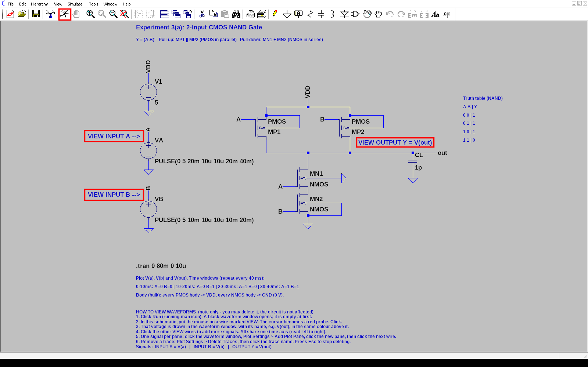

2. **Click Run.** Click the **running-man icon** in the toolbar (top-left red box above), or use the menu *Simulate → Run*.

   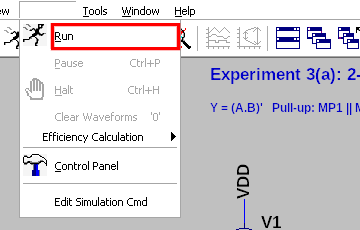

3. **Wait for the simulation to finish.** These circuits take less than a second. The window then splits into two parts:
   a **black waveform window** (top) and your **schematic** (bottom). **The waveform window is empty at first.** This is normal:
   LTspice only draws what you ask for in the next step.

   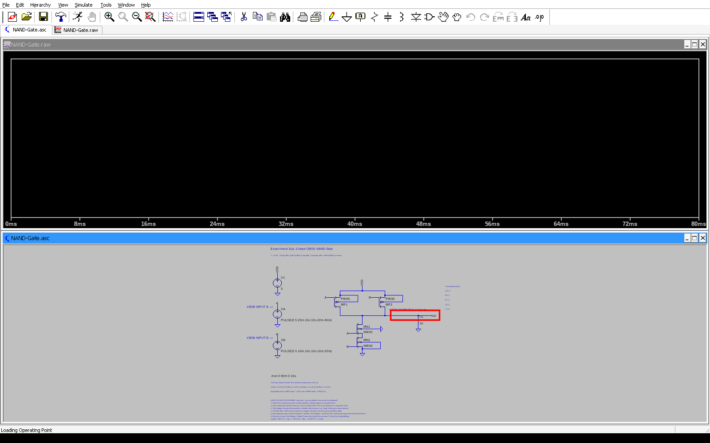

4. **Return to the schematic if necessary.** Click anywhere on the schematic part of the screen (or the `NAND-Gate.asc` tab
   at the top) to work in it again. If the schematic looks small, click it and press **Space**, or use *View → Zoom to Fit*.

## B. Viewing an output

1. **Click the output wire.** Move the mouse over the wire marked `VIEW OUTPUT Y`. When the mouse is exactly on a wire,
   the cursor changes into a **red voltage probe**. Click once with the left mouse button.
2. **The waveform appears.** The voltage of that wire is drawn in the waveform window. The time axis (0 ms, 8 ms, …) runs along
   the bottom, and the voltage axis (0 V … 5 V) is on the left.
3. **Identify the output signal.** The **name of the trace** is written at the top of the plot, in the same colour as the line:
   here it is **`V(out)`**, the voltage of the net labelled `out`.

   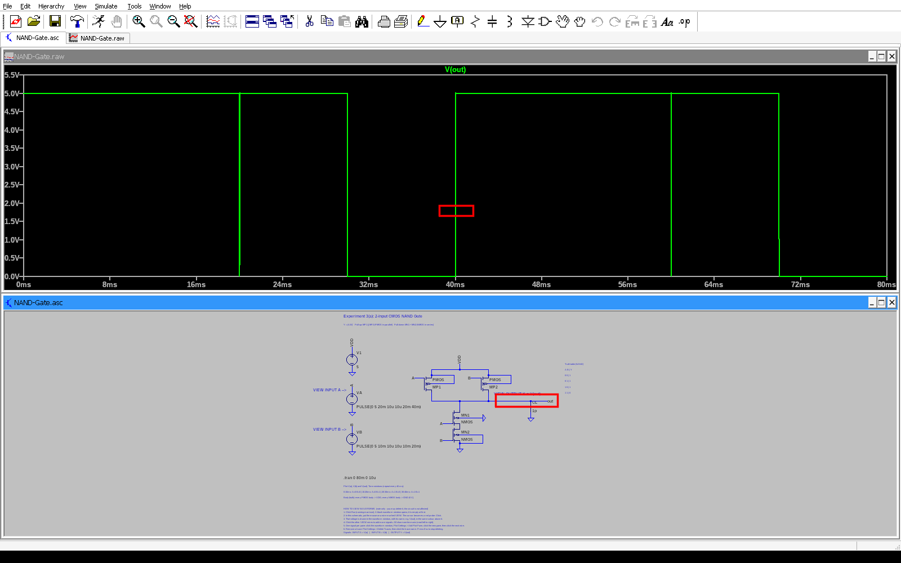

4. **Select another output** (for example `Q'` in a latch, or `CARRY` in the half adder) the same way: click its `VIEW` wire.
   Each new trace gets a new colour and its own name label.

> **Clicking a wire gives a voltage `V(...)`.** Clicking *on a component* (a transistor, resistor or source symbol) gives
> its **current** instead: the cursor looks like a clamp-on current meter. In Experiment 1 that is what you want (`Id(M1)`).
> In all the other experiments, click wires, not components.
>
> **Alternative that always works:** click the waveform window, choose *Plot Settings → Add trace*, select the signal name in
> the list (for example `V(out)` or `Id(M1)`), and click **OK**.
>
> 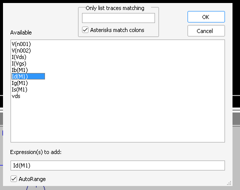

## C. Viewing multiple signals together (inputs and output in time order)

**Quick way:** after showing the output, click the `VIEW INPUT A` wire, then the `VIEW INPUT B` wire. All traces are drawn
in the **same** pane, each in its own colour, with names `V(a)`, `V(b)`, `V(out)` at the top.

**Clearer way (one signal per pane):** this is best for comparing inputs and output.
1. Click once inside the black waveform window to make it active.
2. Open *Plot Settings → Add Plot Pane*. Do this **twice** to get three panes.

   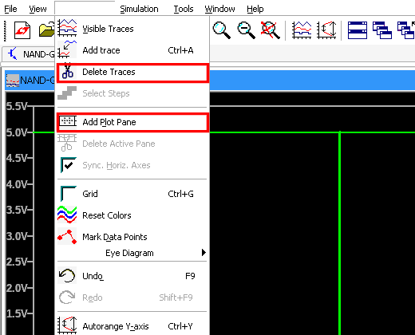

3. Click **inside the top pane**, then click the **INPUT A** wire in the schematic. `V(a)` appears in the top pane.
4. Click **inside the middle pane**, then click the **INPUT B** wire. `V(b)` appears in the middle pane.
5. The output `V(out)` stays in the bottom pane (or click inside it, then click the **OUTPUT Y** wire).

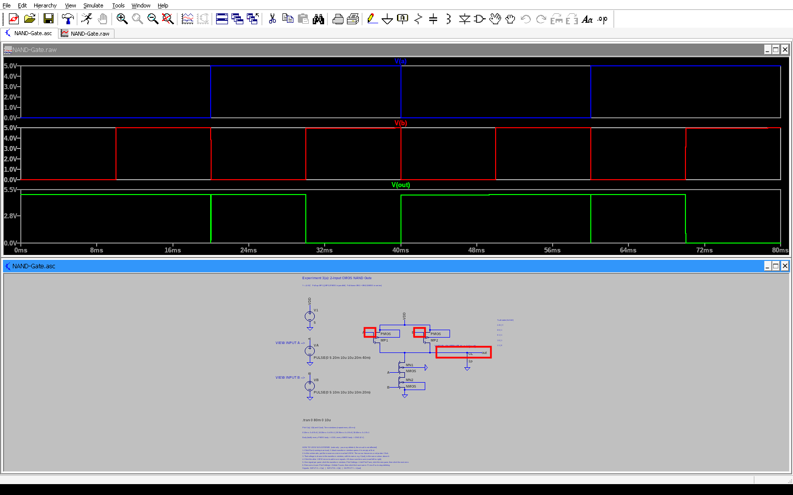

**How to read the waveforms chronologically:** all panes share **one time axis**, so a vertical line through the picture
is one moment in time. Read from **left to right**: in each time window, note the input levels (top panes, 0 V = logic 0,
5 V = logic 1) and check the output level (bottom pane) against the truth table. For the NAND gate above:

| Time window | A | B | Expected Y (NAND) | What you see in V(out) |
|---|---|---|---|---|
| 0–10 ms | 0 | 0 | 1 | 5 V |
| 10–20 ms | 0 | 1 | 1 | 5 V |
| 20–30 ms | 1 | 0 | 1 | 5 V |
| 30–40 ms | 1 | 1 | 0 | 0 V |
| 40–80 ms | (pattern repeats) | | | |

Tip: to read an exact value, click the trace **name** (for example `V(out)`) at the top of its pane. A cross-hair cursor appears
that you can drag along the waveform, and its time and voltage are shown in a small window.

## D. Removing a waveform

To remove one trace from the waveform window:
1. Click inside the waveform window.
2. Choose *Plot Settings → Delete Traces*. The mouse cursor becomes a pair of scissors.
3. **Click the trace name** at the top of the pane (for example `V(b)`). That trace disappears.
4. Press **Esc** to leave delete mode.

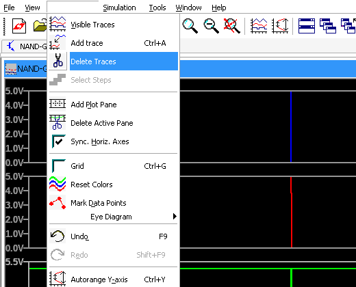
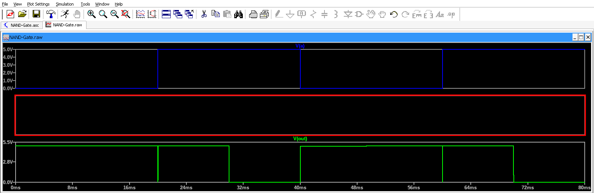

To remove an empty pane, click inside it and choose *Plot Settings → Delete Active Pane*.

> **Removing a waveform is not the same as deleting a wire.**
> * *Plot Settings → Delete Traces* (waveform window) only removes the **picture of the signal**. The circuit is not touched,
>   and you can show the signal again at any time by clicking its wire.
> * *Edit → Delete* in the **schematic** deletes whatever you click next: a wire, a component, a label or a text.
>   Deleting a **wire or component** changes the circuit. Deleting a **text note** does not.
>   If you delete something by mistake, use **Undo** (*Edit → Undo*: F9 in LTspice XVII, Ctrl+Z in LTspice 24),
>   or close the file **without saving**.

## E. Removing the visual indicators

The blue `VIEW …` labels and the `HOW TO VIEW WAVEFORMS` note are LTspice **comment texts**. A comment is not part of the
circuit and is not sent to the simulator, so deleting it does **not** change the circuit or the results.
The real signal names (`A`, `B`, `out`, `Q`, …) are separate **net labels**. They stay, so the nodes `V(a)`, `V(out)` etc.
still exist after the indicators are gone.

**Remove one indicator:**
1. Click the schematic window.
2. Choose *Edit → Delete* (or press **F5** in LTspice XVII). The cursor becomes scissors.
3. Click directly **on the blue text** you want to remove (for example `VIEW INPUT A -->`). It disappears.
4. Press **Esc** to leave delete mode. Save the file (*File → Save*) if you want to keep the change.

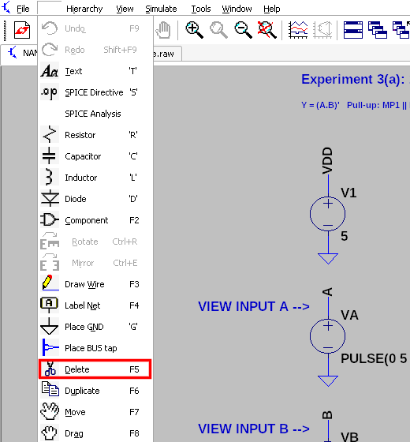
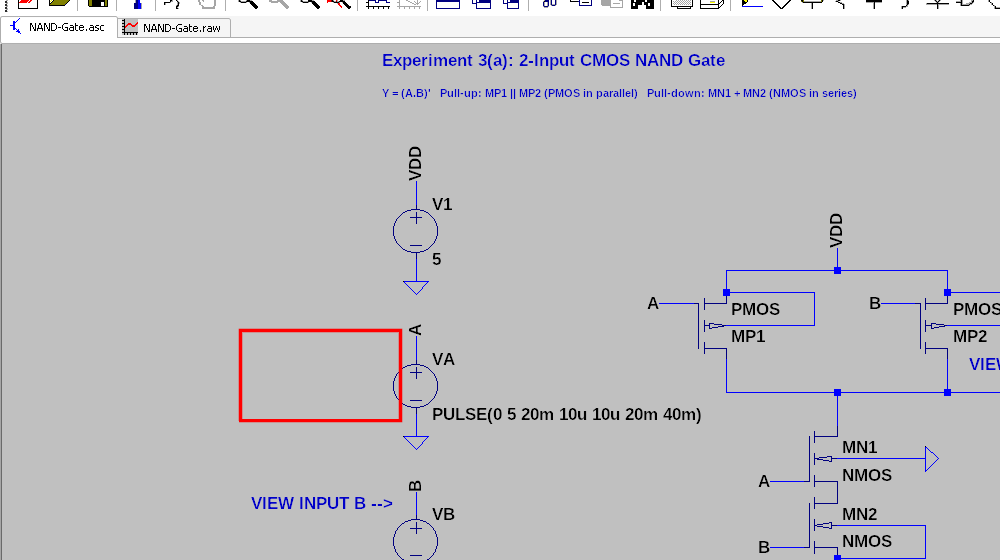

After deleting `VIEW INPUT A -->` and clicking Run again, the simulation gives exactly the same waveforms:

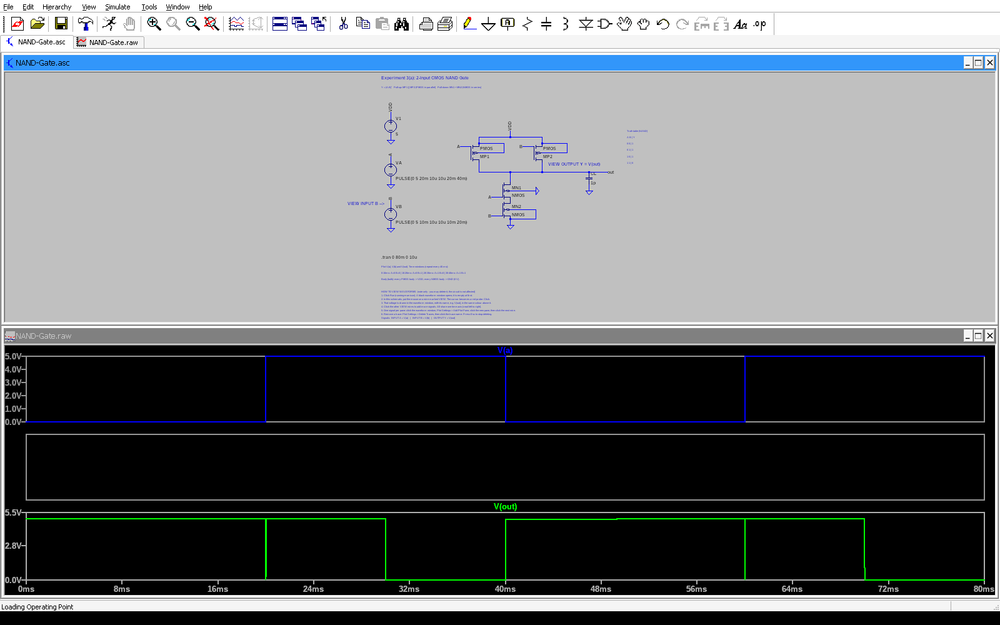

**Be careful:** in delete mode, click **only on blue text**. Do not click the black wires, the net labels (`A`, `B`, `out`), the
transistors or the sources: those are the circuit. The `HOW TO VIEW WAVEFORMS` note is a single text object, so one click removes all of it.

**Restore an indicator you deleted:**
* Immediately: *Edit → Undo* (**F9** in LTspice XVII, **Ctrl+Z** in LTspice 24).

  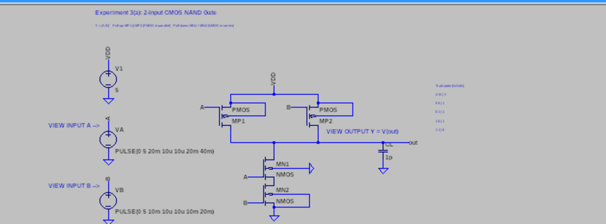
* Later: close the file **without saving**, or download the original `.asc` file from this repository again.

---

# Signal reference tables for every experiment

In every table, **Where to click** refers to the blue `VIEW` label in the schematic. The **Trace name** is what LTspice shows above the waveform.
All screenshots below are **real LTspice waveform windows** of these files (one signal per pane, inputs at the top, outputs at the bottom).

### Experiment 1: NMOS and PMOS characteristics (`.dc` sweeps)
Files: `NMOS-Transfer-Characteristics.asc`, `NMOS-Drain-Characteristics.asc`, `PMOS-Transfer-Characteristics.asc`, `PMOS-Drain-Characteristics.asc`

| Signal | Meaning | Where to click | Trace name |
|---|---|---|---|
| Vgs or Vds | Input: the swept source | **Nothing to click.** It is the **X-axis** of the plot (transfer files: Vgs; drain files: Vds) | (x-axis) |
| Id | Output: drain current of M1 | **On the transistor symbol M1** (current-clamp cursor), or *Plot Settings → Add trace →* `Id(M1)` | `Id(M1)` |

* Transfer files: one curve, Id against Vgs. Drain files: one curve **per Vgs step** (NMOS: Vgs = 3, 4, 5 V; PMOS: 0 … −5 V).
* For the PMOS files the current is negative (it flows out of the drain).

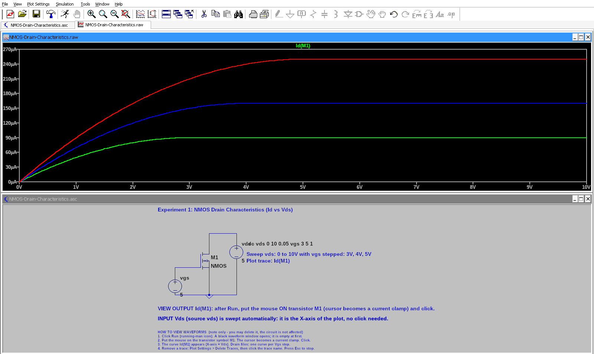

### Experiment 2: CMOS inverter
| File | Signal | Meaning | Where to click | Trace name |
|---|---|---|---|---|
| `Inverter-DC-VTC.asc` | Vin | Input (swept 0 → 5 V) | nothing: it is the **X-axis** | (x-axis) |
| | Vout | Output | `VIEW OUTPUT Vout` wire | `V(vout)` |
| `Inverter-Transient.asc` | Vin | Input pulse | `VIEW INPUT Vin` wire (wire from V1 to the gates) | `V(n002)` |
| | Vout | Output | `VIEW OUTPUT Vout` wire | `V(vout)` |

Time order (transient): 0–10 ms Vin = 5 V → Vout = 0 V; 10–20 ms Vin = 0 V → Vout = 5 V; repeats every 20 ms.
VTC: Vout falls from 5 V to 0 V as Vin rises, switching at about 2.5 V.

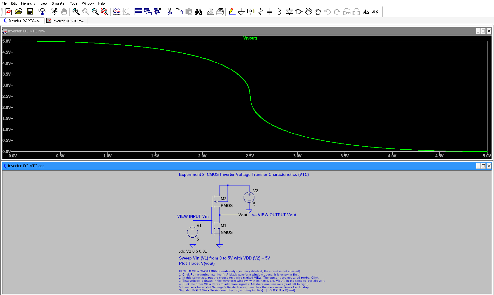
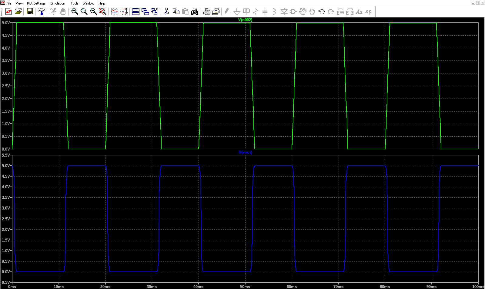

### Experiment 3: NAND and NOR gates
Files: `NAND-Gate.asc`, `NOR-Gate.asc` (identical signals)

| Signal | Meaning | Where to click | Trace name |
|---|---|---|---|
| A | Input A | `VIEW INPUT A -->` (short wire above source VA, or any wire labelled A) | `V(a)` |
| B | Input B | `VIEW INPUT B -->` | `V(b)` |
| Y | Output | `VIEW OUTPUT Y = V(out)` (wire labelled `out`) | `V(out)` |

| Time window (repeats every 40 ms) | A | B | NAND Y | NOR Y |
|---|---|---|---|---|
| 0–10 ms | 0 | 0 | 1 | 1 |
| 10–20 ms | 0 | 1 | 1 | 0 |
| 20–30 ms | 1 | 0 | 1 | 0 |
| 30–40 ms | 1 | 1 | 0 | 0 |

The pull-up network is two PMOS in **parallel** (NAND) or in **series** (NOR). The pull-down network is two NMOS in **series** (NAND)
or in **parallel** (NOR). Every PMOS body is connected to VDD, and every NMOS body to GND.

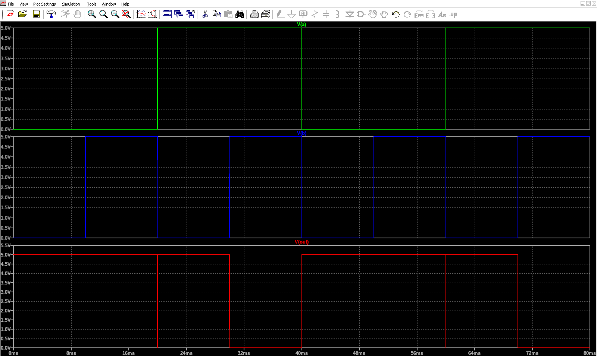
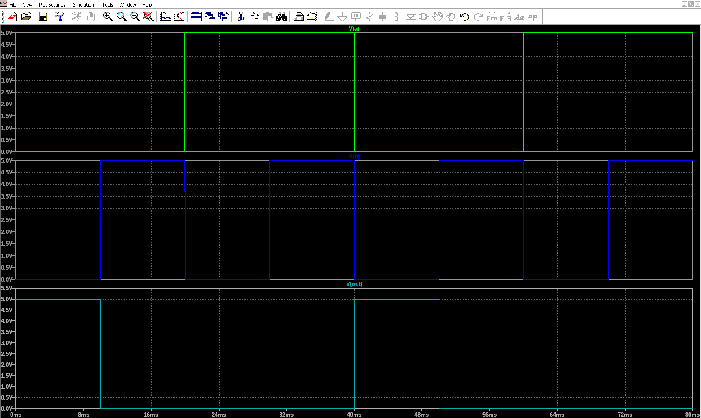

### Experiment 4: Static CMOS logic expressions
Files: `Y1-NOT-A-plus-BC.asc` (Y = (A + B·C)'), `Y2-NOT-A-plus-B-times-C.asc` (Y = ((A + B)·C)')

| Signal | Meaning | Where to click | Trace name |
|---|---|---|---|
| A | Input A | `VIEW INPUT A` (wire at label A, from source V1) | `V(a)` |
| B | Input B | `VIEW INPUT B` (wire at label B, from source V2) | `V(b)` |
| C | Input C | `VIEW INPUT C` (wire at label C, from source V3) | `V(c)` |
| Y | Output | `VIEW OUTPUT Y` (wire at label `out`) | `V(out)` |

These original files use three pulse sources with different periods (A: 20 ms, B: 30 ms, C: 40 ms), so the input combinations
do not appear in counting order. All 8 combinations occur in the 100 ms run. Where to find each one:

| A B C | First seen at | Y1 = (A+BC)' | Y2 = ((A+B)C)' |
|---|---|---|---|
| 0 0 0 | 17–21 ms | 1 | 1 |
| 0 0 1 | 12–17 ms | 1 | 1 |
| 0 1 0 | 32–36 ms | 1 | 1 |
| 0 1 1 | 92–96 ms | 0 | 0 |
| 1 0 0 | 20–30 ms | 0 | 1 |
| 1 0 1 | 6–12 ms | 0 | 0 |
| 1 1 0 | 61–66 ms | 0 | 1 |
| 1 1 1 | 1–6 ms | 0 | 0 |

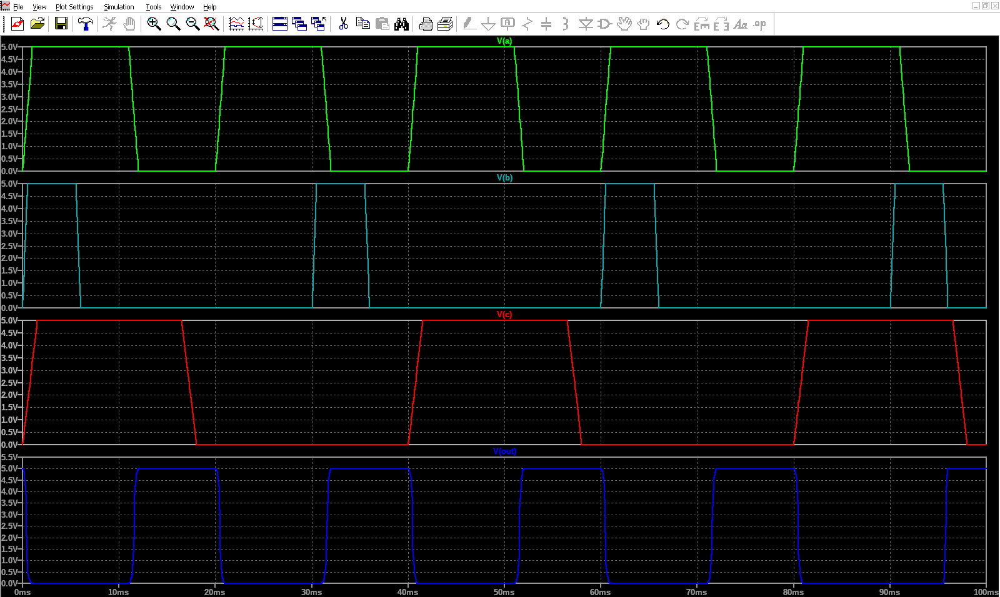
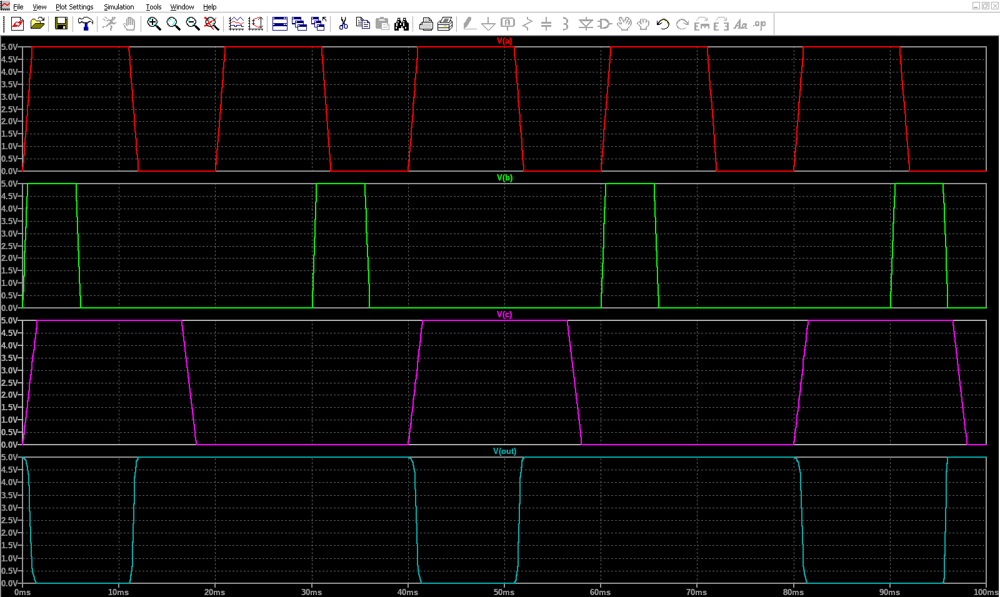

### Experiment 5: SR latch using NAND and NOR

**(a) NAND SR latch:** `SR-Latch-NAND.asc` (inputs are **active-LOW**: S = S', R = R')

| Signal | Meaning | Where to click | Trace name |
|---|---|---|---|
| S' | Set input (active-LOW) | `VIEW INPUT S' (Set, active-LOW) -->` | `V(s)` |
| R' | Reset input (active-LOW) | `VIEW INPUT R' (Reset, active-LOW)` | `V(r)` |
| Q | Latch output | `VIEW OUTPUT Q` (wire labelled Q) | `V(q)` |
| Q' | Complementary output | `VIEW OUTPUT Q' = V(q_)` (wire labelled Q_) | `V(q_)` |

| Time | S' | R' | Operation | Q | Q' |
|---|---|---|---|---|---|
| 0–1.5 ms | 0 | 1 | **Set** | 1 | 0 |
| 1.5–5 ms | 0 | 0 | **Invalid** | 1 | 1 |
| 5–6.5 ms | 1 | 0 | **Reset** | 0 | 1 |
| 6.5–9.5 ms | 1 | 1 | **Hold** (stays reset) | 0 | 1 |
| 15–17.5 ms | 1 | 1 | **Hold** (stays set) | 1 | 0 |

The sequence continues to 50 ms with more Set, Reset, Hold and Invalid intervals; every interval is listed in
[VERIFICATION.md](Documentation/VERIFICATION.md).

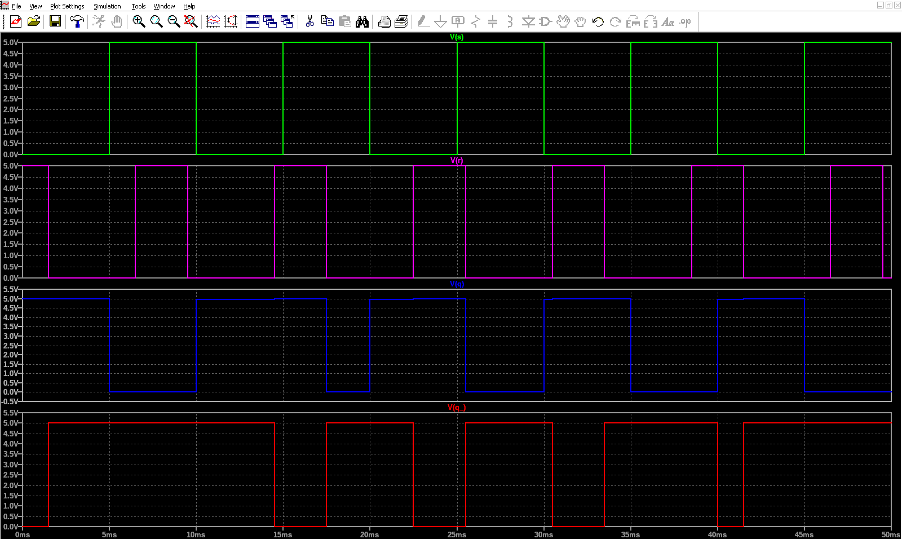

**(b) NOR SR latch:** `SR-Latch-NOR.asc` (active-HIGH inputs; two cross-coupled NOR gates, with feedback through the labels `Q` and `Qbar`)

| Signal | Meaning | Where to click | Trace name |
|---|---|---|---|
| S | Set input | `VIEW INPUT S (Set) -->` | `V(s)` |
| R | Reset input | `VIEW INPUT R (Reset) -->` | `V(r)` |
| Q | Latch output | `VIEW OUTPUT Q` (output wire of gate G2) | `V(q)` |
| Q' | Complementary output | `VIEW OUTPUT Qbar` (output wire of gate G1) | `V(qbar)` |

| Time | S | R | Operation | Q | Q' |
|---|---|---|---|---|---|
| 0–10 ms | 1 | 0 | **Set** | 1 | 0 |
| 10–20 ms | 0 | 0 | **Hold** (remembers 1) | 1 | 0 |
| 20–30 ms | 0 | 1 | **Reset** | 0 | 1 |
| 30–40 ms | 0 | 0 | **Hold** (remembers 0) | 0 | 1 |
| 40–50 ms | 1 | 1 | **Invalid** (forbidden) | 0 | 0 |
| 50–60 ms | 0 | 1 | **Reset** again | 0 | 1 |

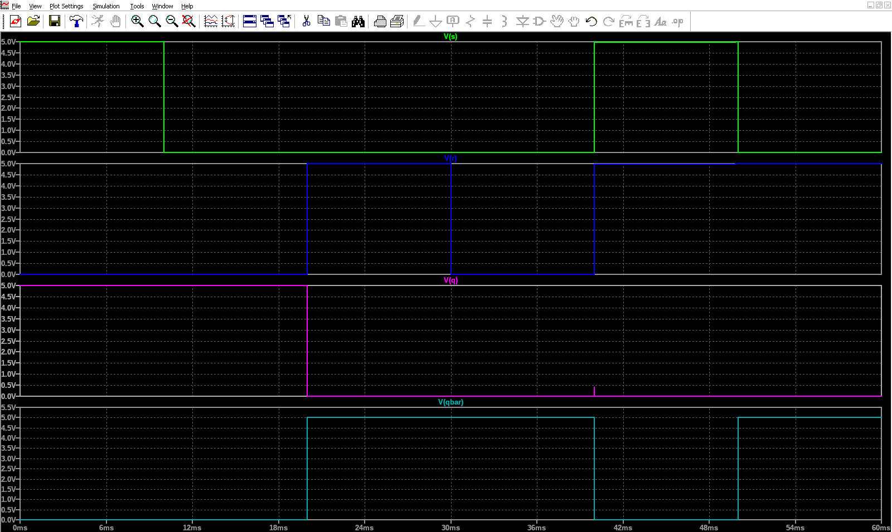

### Experiment 6: Multiplexers

**(a) 4:1 MUX (transmission gates):** `MUX-4to1-TG.asc`. Y = S1'S0'·I0 + S1'S0·I1 + S1S0'·I2 + S1S0·I3

| Signal | Meaning | Where to click | Trace name |
|---|---|---|---|
| S1, S0 | Select inputs (S1 = MSB) | `VIEW SELECT S1 -->`, `VIEW SELECT S0 -->` | `V(s1)`, `V(s0)` |
| I0 … I3 | Data inputs | `VIEW INPUT I0 -->` … `VIEW INPUT I3 -->` | `V(i0)` … `V(i3)` |
| Y | Output | `VIEW OUTPUT Y` (wire labelled `output`) | `V(output)` |

| Time | S1 S0 | Selected input | What V(output) shows |
|---|---|---|---|
| 0–10 ms | 0 0 | I0 | the fast square wave of I0 |
| 10–20 ms | 0 1 | I1 | the slower square wave of I1 |
| 20–30 ms | 1 0 | I2 | one 5 ms pulse (I2) |
| 30–40 ms | 1 1 | I3 | constant HIGH (I3) |

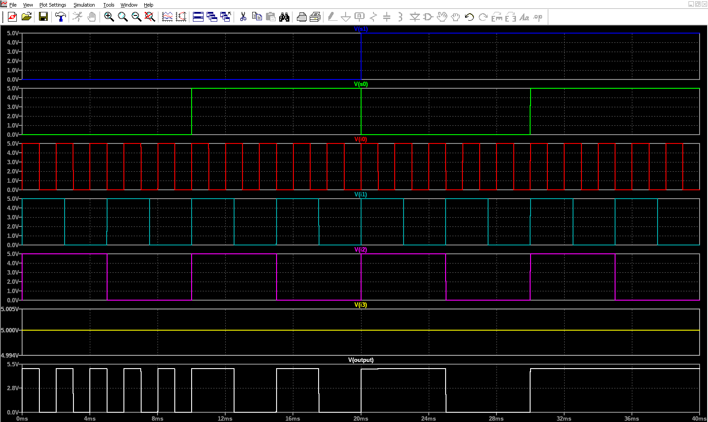

**(b) 2:1 MUX (logic gates):** `MUX-2to1-Gates.asc`, and **(c) 2:1 MUX (transmission gates):** `MUX-2to1-TG.asc`. Y = S'·D0 + S·D1

| Signal | Meaning | Where to click | Trace name |
|---|---|---|---|
| S | Select input | `VIEW SELECT S -->` | `V(s)` |
| D0 | Data input 0 | `VIEW INPUT D0 -->` | `V(d0)` |
| D1 | Data input 1 | `VIEW INPUT D1 -->` | `V(d1)` |
| Y | Output | `VIEW OUTPUT Y` | `V(y)` |

| Time | S | D0 | D1 | Y | Explanation |
|---|---|---|---|---|---|
| 0–5 ms | 0 | 0 | 0 | 0 | S = 0, so Y follows D0 |
| 5–10 ms | 0 | 0 | 1 | 0 | |
| 10–15 ms | 0 | 1 | 0 | 1 | |
| 15–20 ms | 0 | 1 | 1 | 1 | |
| 20–25 ms | 1 | 0 | 0 | 0 | S = 1, so Y follows D1 |
| 25–30 ms | 1 | 0 | 1 | 1 | |
| 30–35 ms | 1 | 1 | 0 | 0 | |
| 35–40 ms | 1 | 1 | 1 | 1 | |

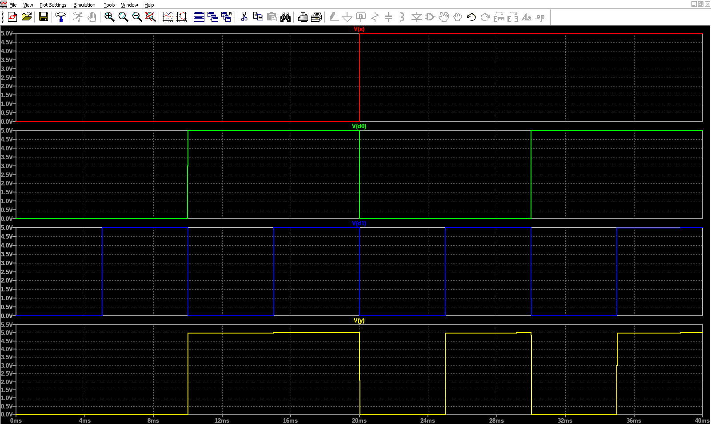
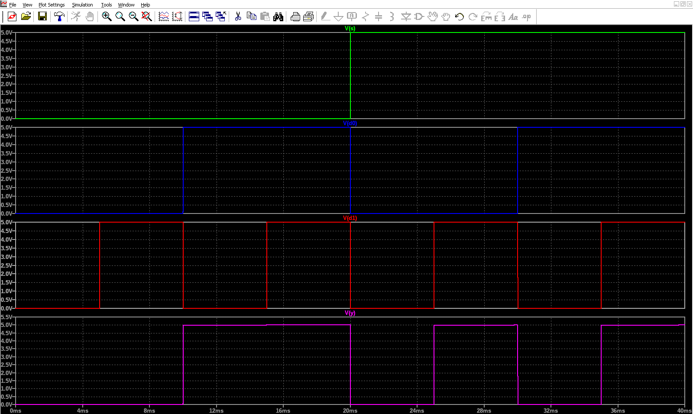

### Experiment 7: Static CMOS half adder
File: `Half-Adder.asc`

| Signal | Meaning | Where to click | Trace name |
|---|---|---|---|
| A | Input A | `VIEW INPUT A -->` (wire at label A, far left) | `V(a)` |
| B | Input B | `VIEW INPUT B -->` (wire at label B, far left) | `V(b)` |
| SUM | Sum output, A ⊕ B | `VIEW OUTPUT SUM` (wire at label `sum`) | `V(sum)` |
| CARRY | Carry output, A·B | `VIEW OUTPUT CARRY` (wire at label `Carry`, far right) | `V(carry)` |

| Time window (repeats every 40 ms) | A | B | SUM | CARRY |
|---|---|---|---|---|
| 0–10 ms | 0 | 0 | 0 | 0 |
| 10–20 ms | 0 | 1 | 1 | 0 |
| 20–30 ms | 1 | 0 | 1 | 0 |
| 30–40 ms | 1 | 1 | 0 | 1 |

This schematic is large: after clicking Run, press **Space** in the schematic (zoom to fit) and use the mouse wheel to zoom in on a label.

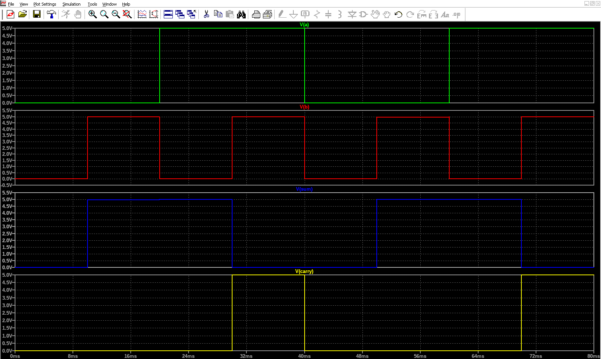

### Experiment 8: 4×4 NOR ROM
File: `NOR-ROM-4x4.asc`

| Signal | Meaning | Where to click | Trace name |
|---|---|---|---|
| R1 … R4 | Word lines (inputs: one row is selected at a time) | `VIEW INPUT R1 (row wire) -->` … R4 (the horizontal row wires) | `V(r1)` … `V(r4)` |
| C1 … C4 | Bit lines (outputs: the stored data) | `^ VIEW OUTPUTS` (the vertical column wires labelled C1 … C4) | `V(c1)` … `V(c4)` |

| Time (repeats every 10 ms) | Active row | C1 | C2 | C3 | C4 |
|---|---|---|---|---|---|
| 0.5–3 ms | R1 | 0 | 1 | 0 | 1 |
| 3–5.5 ms | R2 | 0 | 0 | 1 | 1 |
| 5.5–8 ms | R3 | 1 | 0 | 0 | 1 |
| 8–10.5 ms | R4 | 0 | 1 | 1 | 0 |

A stored **0** reads about 0.26 V and a **1** reads 5 V. When no row is active (0–0.5 ms), all bit lines are 1.

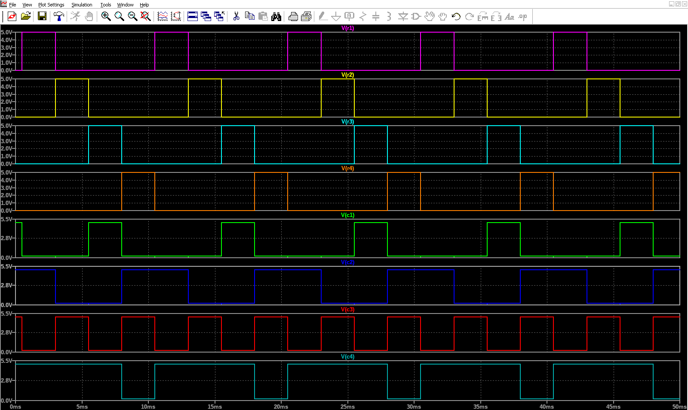

---

## Experiment list

| No. | Experiment | Files | Description |
|---|---|---|---|
| 1 | NMOS and PMOS characteristics | `NMOS-Transfer-Characteristics.asc` `NMOS-Drain-Characteristics.asc` `PMOS-Transfer-Characteristics.asc` `PMOS-Drain-Characteristics.asc` | DC sweeps of `Id` vs `Vgs` (transfer) and `Id` vs `Vds` (drain, stepped `Vgs`). |
| 2 | CMOS inverter | `Inverter-DC-VTC.asc` `Inverter-Transient.asc` | Voltage transfer characteristic and transient switching. |
| 3 | CMOS NAND and NOR gates | `NAND-Gate.asc` `NOR-Gate.asc` | **Corrected and simplified** 2-input static CMOS NAND and NOR. |
| 4 | Static CMOS logic expressions | `Y1-NOT-A-plus-BC.asc` → Y = (A + B·C)' `Y2-NOT-A-plus-B-times-C.asc` → Y = ((A + B)·C)' | Complex static CMOS gates. |
| 5 | SR latch | `SR-Latch-NAND.asc` `SR-Latch-NOR.asc` | NAND-based latch (active-LOW inputs), plus a **new** NOR-based latch. |
| 6 | Multiplexer | `MUX-4to1-TG.asc` `MUX-2to1-Gates.asc` `MUX-2to1-TG.asc` | 4:1 MUX using CMOS transmission gates, plus a **new** 2:1 MUX (gate-level, and a transmission-gate version). |
| 7 | Static CMOS half adder | `Half-Adder.asc` | Sum = A ⊕ B, Carry = A·B. |
| 8 | NOR-based ROM | `NOR-ROM-4x4.asc` | 4×4 pseudo-NMOS NOR ROM. |

The `Documentation` folder contains:
* `how-to-view/`: LTspice screenshots of the waveform-viewing steps (sections A–E above),
* `ltspice-waveforms/`: LTspice waveform-window screenshots of every experiment,
* `schematics/`: LTspice screenshots of every schematic, including the indicators,
* `waveforms/`: plots drawn from LTspice's output data, used by the verification report,
* `VERIFICATION.md`: the measured results for every circuit and input combination,
* `CHANGES.md`: what was changed compared with the original files, and why.

## Changes compared with the original files
* **NAND and NOR gates (Exp 3):** redrawn as clean, simple CMOS gates that give the correct output for all four input combinations.
* **NAND-based and NOR-based SR latch (Exp 5):** the NAND latch is preserved (with its Q / Q' labels corrected), and a NOR latch was added.
* **4:1 and 2:1 multiplexers (Exp 6):** the 4:1 transmission-gate MUX keeps its function and structure, and 2:1 MUXes were added.
* **Experiments 1, 2 and 4:** the circuits are the original files. The only addition is the waveform indicators, which are comment text only.
* **Experiments 7 and 8:** original drawings, with very small wiring/sizing corrections.
* **All experiments:** the `VIEW …` indicators and `HOW TO VIEW WAVEFORMS` notes were added as comment text. It was checked that
  LTspice produces the identical netlist with and without them (see [VERIFICATION.md](Documentation/VERIFICATION.md)).

All corrections, with before/after measurements, are listed in [Documentation/CHANGES.md](Documentation/CHANGES.md).

---

## Troubleshooting

| Problem | What to do |
|---|---|
| **File does not open in LTspice / LTspice shows HTML text** | You saved the GitHub web page instead of the file. Download it again with **Download raw file**, or download the ZIP. Make sure the file name ends in `.asc` (not `.asc.txt`). |
| **"Unknown subcircuit" / missing model** | Not expected: only standard LTspice parts are used. Make sure you are using a full LTspice installation (XVII or 24.x). The `NMOS` / `PMOS` model names are LTspice's built-in defaults and need no library. |
| **Simulation error / "time step too small"** | Reopen the original file (maybe a part was moved or deleted by accident), then run again. Do not delete the `.tran` / `.dc` command text (black text). |
| **The waveform window stays empty after Run** | This is normal. Click a `VIEW` wire in the schematic (part B above), or use *Plot Settings → Add trace*. |
| **Clicking does nothing / I get a current `I(...)` instead of a voltage** | Put the mouse exactly on a **wire** (the cursor must become the red voltage probe) rather than on a symbol. Zoom in with the mouse wheel if the wire is small. Or use *Plot Settings → Add trace*. |
| **All traces are on top of each other** | Use *Plot Settings → Add Plot Pane* and click inside a pane before clicking each wire (part C above). |
| **Input waveforms look wrong** | Right-click the source to see its `PULSE(...)`/`PWL(...)` value and compare it with this README. The time axis is in ms, and the run length is set by the `.tran` command. |
| **I deleted part of the circuit by mistake** | *Edit → Undo* (F9 in LTspice XVII, Ctrl+Z in LTspice 24), or close without saving and reopen / re-download the file. |
| **The plot shows "V(n002)" etc.** | Unlabelled nodes get automatic names. Use the labelled nodes listed in the signal tables above. |
| **Missing dependencies** | There are none. Each experiment is a single self-contained `.asc` file. |
| **Exp 6(b) gate symbols missing** | The NOT/AND/OR gates are in LTspice's standard `[Digital]` symbol folder, which every installation includes. |
